

  

  &nbsp;
  &nbsp;
  &nbsp;
  

 

  

  

  

### AI Projects

  <a href="https://github.com/Eric-Souza/voice-receptionist-copilot">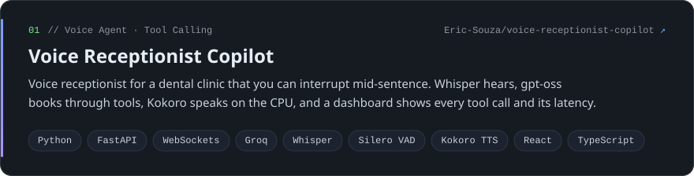</a>

  <a href="https://github.com/Eric-Souza/doc-extraction-copilot">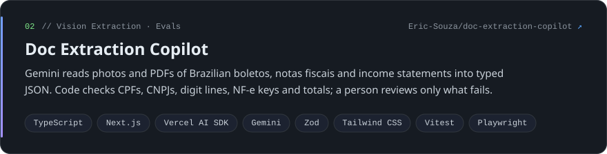</a>

  <a href="https://github.com/Eric-Souza/renda-fixa-copilot">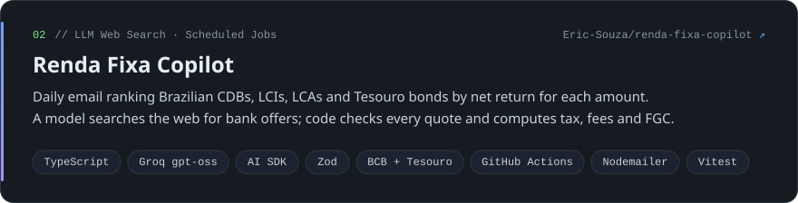</a>

  <a href="https://github.com/Eric-Souza/currency-copilot">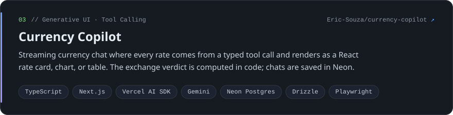</a>

<b>See 6 more AI projects</b>

 

  <a href="https://github.com/Eric-Souza/job-application-copilot">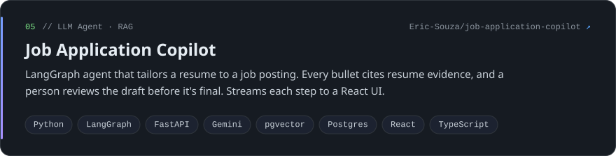</a>

  <a href="https://github.com/Eric-Souza/profile-mcp-server">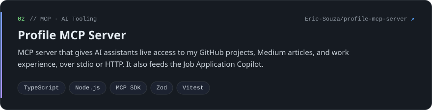</a>

  

  

  

  

### Publications

  <a href="https://blog.devgenius.io/i-built-a-voice-receptionist-you-can-interrupt-on-a-free-stack-4f48b16a13ab">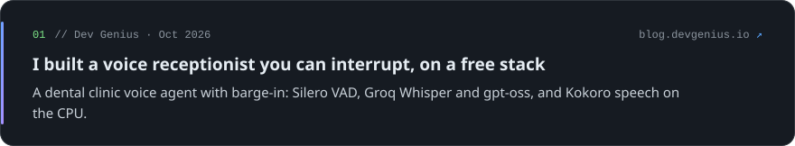</a>

  <a href="https://blog.devgenius.io/close-enough-isnt-good-enough-teaching-an-ai-assistant-to-find-the-exact-answer-1d127caad4b7">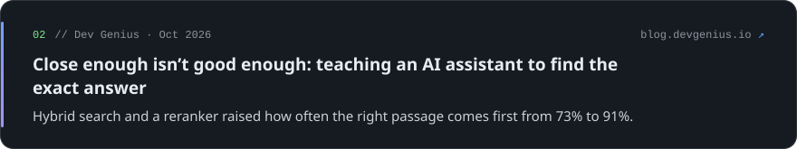</a>

  <a href="https://blog.devgenius.io/i-built-an-ai-that-tailors-my-resume-then-spent-most-of-the-time-stopping-it-from-making-things-up-fbbee576a9ad">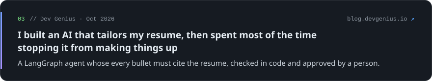</a>

<b>See 17 more publications</b>

 

  <a href="https://blog.stackademic.com/how-do-you-know-your-ai-assistant-didnt-get-worse-grading-every-change-automatically-155bbbaa024d">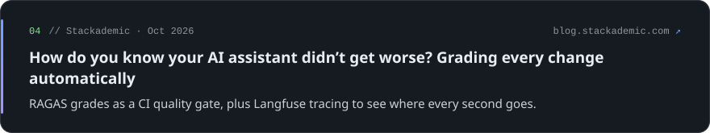</a>

  <a href="https://blog.devgenius.io/i-built-a-daily-email-that-finds-the-best-brazilian-cdbs-and-checks-the-ai-before-trusting-it-e74e4747d163">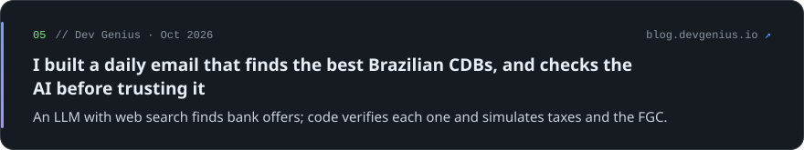</a>

  <a href="https://blog.devgenius.io/i-built-a-vision-ai-that-reads-brazilian-boletos-and-invoices-and-code-that-checks-every-digit-it-22b4b8ce2cc2">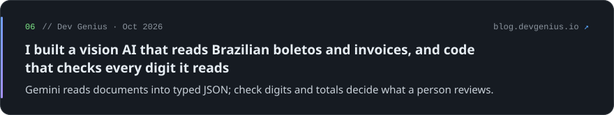</a>

  <a href="https://blog.stackademic.com/i-built-a-currency-chat-where-the-answers-are-charts-not-paragraphs-58e74327b22f">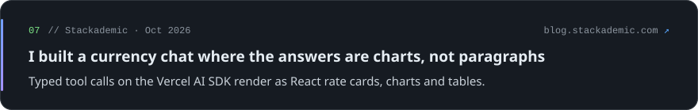</a>

  <a href="https://blog.stackademic.com/building-a-daily-usd-brl-exchange-advisor-on-free-infrastructure-6f4753bae25c">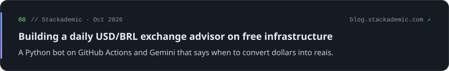</a>

  <a href="https://blog.stackademic.com/building-a-grounded-document-q-a-app-with-gemini-langgraph-and-chroma-07a1b230b9d5">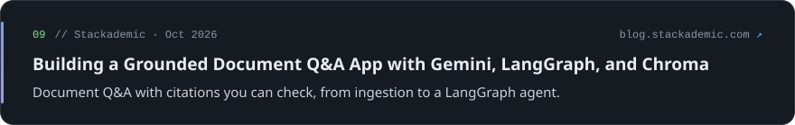</a>

  <a href="https://blog.stackademic.com/building-a-clinical-session-review-console-where-the-boring-parts-are-the-point-cd3df897e4ae">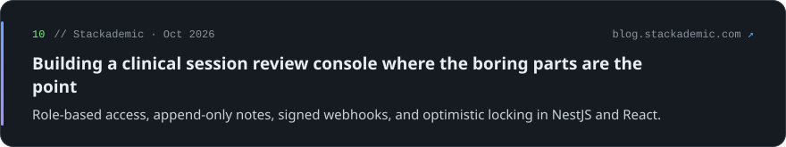</a>

  <a href="https://blog.stackademic.com/llms-propose-python-enforces-building-a-local-first-ai-travel-planner-api-4a1b31aa4b99">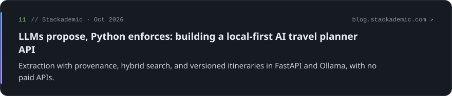</a>

  <a href="https://blog.stackademic.com/building-a-production-style-document-q-a-system-with-gemini-langchain-and-fastapi-97c73b47fd4b">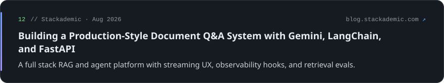</a>

  <a href="https://blog.stackademic.com/dispatchbot-keeping-ai-conversations-honest-with-server-side-job-validation-70283668f24f">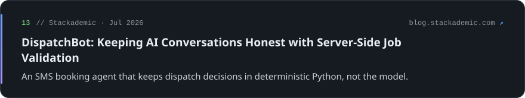</a>

  <a href="https://medium.com/stackademic/building-an-effective-node-api-using-express-and-sequelize-9b875b7d7795">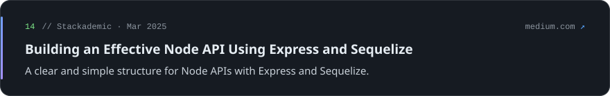</a>

  <a href="https://medium.com/remedy-product-studio/understanding-aws-essential-concepts-for-software-engineers-07b114954bd2">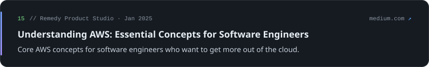</a>

  <a href="https://medium.com/remedy-product-studio/mimicking-youtubes-ui-with-react-native-web-a-fully-responsive-video-browsing-app-40a4f5f9244f">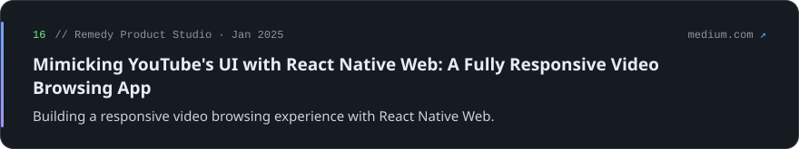</a>

  <a href="https://medium.com/remedy-product-studio/building-blocks-of-python-for-web-development-45c078c5f208">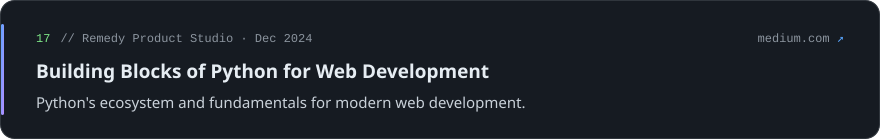</a>

  <a href="https://medium.com/remedy-product-studio/building-a-secure-and-scalable-back-end-with-nestjs-typescript-and-typeorm-ad8ae5c9c0c0">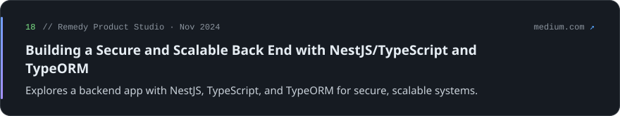</a>

  <a href="https://medium.com/remedy-product-studio/building-a-global-github-profile-search-app-with-react-tailwind-css-daisy-ui-and-axios-e854158bb7b2">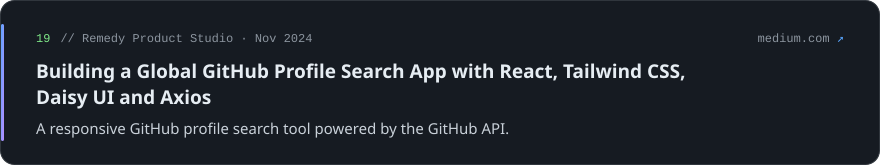</a>

  <a href="https://medium.com/remedy-product-studio/mastering-object-oriented-programming-in-javascript-es2022-a-guide-for-engineers-5a89ebc0996e">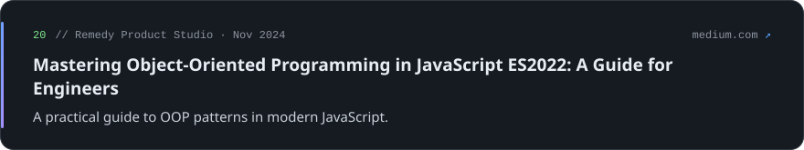</a>

Also on <a href="https://medium.com/@eric.bh18souza">Medium</a>

### Most Used Languages

  

